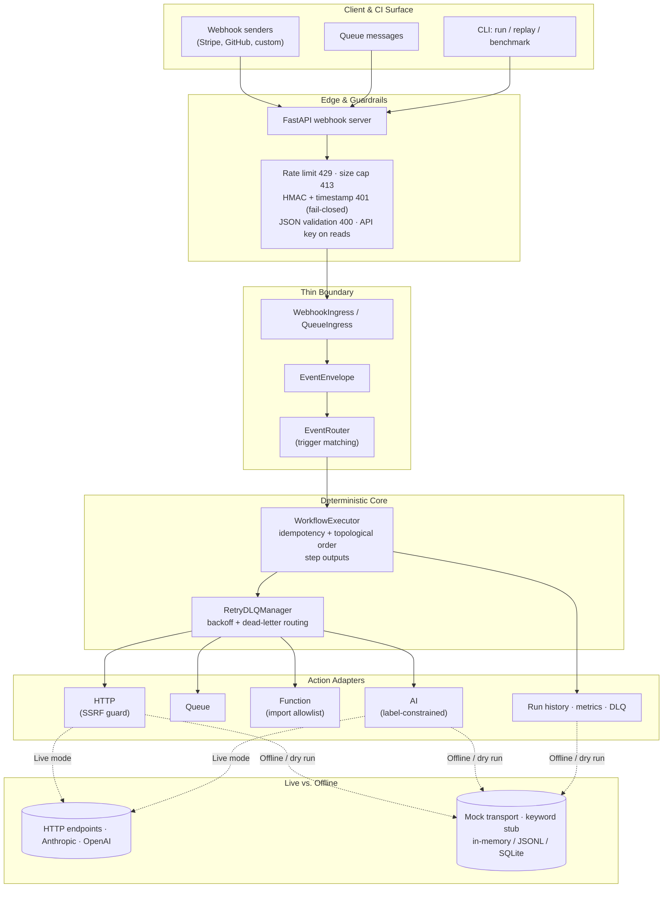
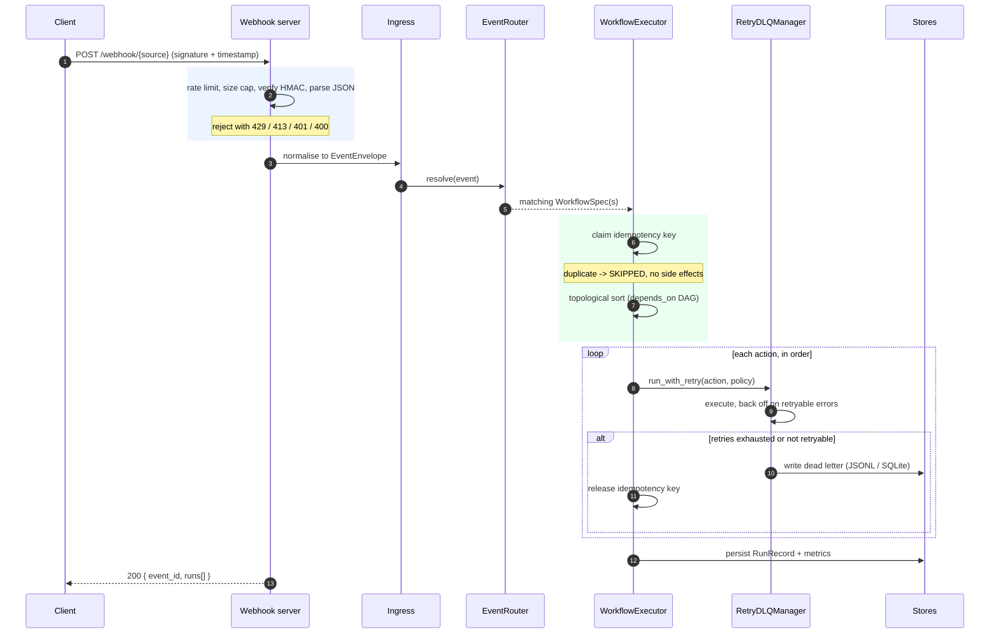

# Event-Triggered Automation Agent (ETAA)

[](https://github.com/AshraHossain/event-triggered-automation-agent/actions/workflows/ci.yml)


A vendor-agnostic event orchestration engine. It takes webhooks and queue messages, matches
them against declarative YAML workflows, and runs the actions with idempotency, retry with
backoff, and a replayable dead-letter queue.

```bash
make install && make demo     # offline demo: 2 successes, 1 duplicate skipped, 1 dead-lettered
make check                    # lint, types, security scan, 107 tests (95% coverage)
```

## Architecture

### Layered system



### End-to-end request flow



## What it handles

| Problem | How ETAA handles it |
|---|---|
| The same event is delivered twice | `(workflow_id, event_id)` is claimed before a run; the duplicate is recorded as `skipped` and nothing executes. |
| A downstream call fails temporarily | Per-action retry policy with fixed or exponential backoff and a list of retryable error codes. |
| A call fails for good | The event is written to a dead-letter store (JSONL or SQLite) with the error, and `etaa replay` re-runs it later. |
| A failed event is redelivered | The idempotency claim is released on failure, so the redelivery runs instead of being skipped. |
| One step needs the result of another | Action outputs are passed forward: `{{steps.<action_id>.<path>}}`. |
| "What happened to event X?" | Every run is stored with per-action attempts, errors and latency; metrics are exposed as JSON and in Prometheus format. |

## Quickstart

```bash
git clone https://github.com/AshraHossain/event-triggered-automation-agent.git
cd event-triggered-automation-agent
make install          # uv venv && uv pip install -e ".[dev]"
```

Run a demo (no network or API key needed — HTTP calls go to a mock endpoint):

```bash
PYTHONPATH=. uv run python examples/payment_webhook/demo.py
```

```text
── Event #1: evt_pay_001 ──   status=success
── Event #2: evt_pay_002 ──   status=success
── Event #3: evt_pay_001 ──   status=skipped              (duplicate)
── Event #4: evt_pay_003 ──   status=failed  attempts=3   (email down → dead-lettered)
```

Replay the dead letter once the downstream is healthy:

```bash
uv run etaa replay data/dlq/payment.jsonl --workflows examples/payment_webhook --dry-run
# { "replayed": 1, "succeeded": 1, "failed": 0, "skipped": 0 }
```

Run the server and send an event:

```bash
uv run etaa server --workflows examples/ --port 8000 --dry-run

curl -X POST http://localhost:8000/api/v1/webhook/stripe \
  -H "Content-Type: application/json" \
  -d '{"id":"evt_1","type":"payment_succeeded","data":{"customer_email":"a@example.com","success":true}}'

curl http://localhost:8000/api/v1/runs
curl http://localhost:8000/api/v1/metrics/prometheus
```

`--dry-run` renders and validates HTTP actions without sending them; drop it to call real endpoints.

Or with Docker:

```bash
docker build -t etaa . && docker run -p 8000:8000 etaa
```

## Workflows

A workflow is a YAML file: when to run, what to do, and what to do when it fails.

```yaml
id: support-ticket-flow
name: Support Ticket Automation
triggers:                       # OR across triggers; AND across source/type/filters
  - source: support_system
    type: ticket_created
actions:
  - id: classify_ticket
    type: ai
    config:
      provider: stub            # stub | anthropic | openai
      prompt: "Classify this support ticket.\nTicket: {{payload.description}}"
      labels: [billing, technical, account, general]
      default_label: general
  - id: send_ack_email
    type: http
    depends_on: [classify_ticket]
    config:
      method: POST
      url: "https://api.example.com/emails/send"
      headers:
        Authorization: "Bearer {{env.ETAA_SECRET_EMAIL_TOKEN}}"
      body:
        to: "{{payload.requester_email}}"
        body: "Your ticket was categorised as {{steps.classify_ticket.classification}}."
    retry_policy:
      max_attempts: 3
      backoff_strategy: exponential
      backoff_seconds: 1.0
      retryable_error_codes: [429, 500, 503, "timeout"]
dlq:
  target_type: db               # file | db (SQLite); `queue` falls back to a file
  target_config: { db_path: ./data/dlq/support.db, table_name: dlq_support_tickets }
```

| Placeholder | Value |
|---|---|
| `{{event_id}}`, `{{source}}`, `{{type}}` | Event envelope fields |
| `{{payload.a.b}}` | A value from the event payload |
| `{{steps.<action_id>.<path>}}` | Output of an earlier action in the same run |
| `{{env.ETAA_SECRET_<NAME>}}` | A secret from the environment (only this prefix is readable) |

Action types: `http`, `queue` (in-memory), `function` (local Python callable), `ai`.

| Example | Trigger | Actions |
|---|---|---|
| `examples/payment_webhook/` | Stripe `payment_succeeded` | Email (HTTP) → CRM update (function) |
| `examples/gitops_automation/` | GitHub `push` to `main` | Start CI (function) → Slack (HTTP) |
| `examples/support_ticket_flow/` | `ticket_created` | Classify (AI) → assign owner → email |

Step-by-step walkthroughs are in [docs/](docs/).

## Benchmark

`make benchmark` replays 150 synthetic events × 20 iterations across the three example
workflows on a mock HTTP transport, so it measures engine overhead rather than a network.

| Workflow | Events | Success | Failure | Avg latency per run |
|---|---|---|---|---|
| gitops-automation | 1,000 | 1,000 | 0 | 0.1 ms |
| payment-webhook | 1,000 | 1,000 | 0 | 0.1 ms |
| support-ticket-flow | 1,000 | 1,000 | 0 | 0.1 ms |

About 3,900 events per second in a single process on a laptop, with JSONL run history and the
in-memory idempotency store.

## Security

| Control | Behaviour | Configuration |
|---|---|---|
| Webhook signatures | HMAC-SHA256 over `timestamp.body`, constant-time compare. Unsigned or unknown sources are rejected once any secret is set (fail closed). | `ETAA_WEBHOOK_SECRET`, `ETAA_WEBHOOK_SECRET_<SOURCE>`, `ETAA_WEBHOOK_UNSIGNED_SOURCES` |
| Replay protection | Requests older than the tolerance window are rejected. | `ETAA_WEBHOOK_TOLERANCE_SECONDS` (default 300) |
| Request limits | 413 over the body cap; 429 over the per-client rate. | `ETAA_MAX_BODY_BYTES` (1 MiB), `ETAA_RATE_LIMIT_PER_MINUTE` (600) |
| Read-endpoint auth | `/runs`, `/metrics`, `/workflows` require a key when one is set. | `ETAA_API_KEY` (`X-API-Key` or `Authorization: Bearer`) |
| Outbound request guard | Only `http(s)`; private, loopback and link-local hosts blocked; payload values percent-encoded in URLs. | `ETAA_HTTP_ALLOWED_HOSTS`, `ETAA_HTTP_ALLOW_PRIVATE=1` |
| Function import allowlist | `function` actions can only import allow-listed module prefixes. | `ETAA_FUNCTION_ALLOWLIST` (default `examples.,etaa.`) |
| Secrets | Workflow files reference `{{env.ETAA_SECRET_*}}`; no other environment variable can be read from a spec. | — |
| AI output containment | Payload text is passed as data; the model's answer is forced into the configured `labels`. | `labels`, `default_label` |
| Supply chain | `bandit` and `pip-audit` in CI, Dependabot, non-root container image. | — |

Signing a request:

```bash
SECRET=shh; TS=$(date +%s)
BODY='{"id":"e1","type":"payment_succeeded","data":{"success":true}}'
SIG="sha256=$(printf '%s.%s' "$TS" "$BODY" | openssl dgst -sha256 -hmac "$SECRET" | awk '{print $NF}')"
curl -X POST http://localhost:8000/api/v1/webhook/stripe \
  -H "Content-Type: application/json" \
  -H "X-ETAA-Timestamp: $TS" -H "X-ETAA-Signature: $SIG" -d "$BODY"
```

## Limits

- **Single node.** The rate limiter and the default idempotency store are in-process. Set
  `ETAA_IDEMPOTENCY_DB` for a SQLite store that survives restarts; a multi-host deployment
  needs a shared store (Redis or a database) behind the same interface.
- **At-least-once per action.** A retried or replayed workflow starts again from its first
  action, so actions should be safe to repeat.
- **No message-broker adapters yet.** The `queue` action and ingress are in-memory; SQS,
  Kafka and RabbitMQ are not implemented and fail loudly if configured.
- **Outbound host check does not resolve DNS.** Use `ETAA_HTTP_ALLOWED_HOSTS` when workflow
  files are not fully trusted.
- **Encryption at rest, mTLS and secret-manager integration** are left to the platform.

## Project layout

| Path | Responsibility |
|---|---|
| `etaa/models/` | Pydantic schemas: `EventEnvelope`, `WorkflowSpec`, `ActionSpec`, `RetryPolicy`, `DLQConfig`, `RunRecord` |
| `etaa/engine/` | `EventRouter`, `WorkflowExecutor`, `IdempotencyManager`, `RetryDLQManager`, dead-letter store |
| `etaa/ingress/` | Webhook/queue normalisation, signature verification, FastAPI server |
| `etaa/actions/` | One module per action type: `http`, `queue`, `function`, `ai` |
| `etaa/templating.py` | Placeholder rendering shared by all actions |
| `etaa/observability/` | JSON logger, metrics store, run-history store (JSONL or SQLite) |
| `examples/` | Three end-to-end workflows with offline demos |
| `tests/` | 107 offline tests (mocked HTTP, in-memory stores) |

## Development

```bash
make check        # ruff, black, mypy, bandit, pip-audit, pytest (coverage gate 90%)
make test
```

To add an action type, add a module under `etaa/actions/` that subclasses `BaseAction`,
add the kind to `ActionKind`, and register it in `build_application` in `etaa/main.py`.
See [AGENTS.md](AGENTS.md) for conventions and [CHANGELOG.md](CHANGELOG.md) for history.

## License

[MIT](LICENSE)
